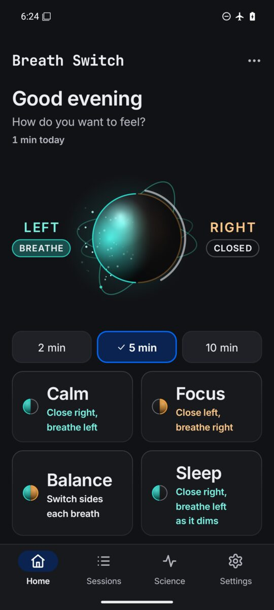

  

<h1 align="center">Breath Switch</h1>

Breathing exercises for stress relief, calm, focus and sleep, through one nostril or both in turn. Pay once, no ads, fully offline.

  <a href="https://play.google.com/store/apps/details?id=com.zanoshky.breathswitch"><b>Google Play</b></a> ·
  <a href="https://breathswitch.zanoski.com"><b>breathswitch.zanoski.com</b></a> ·
  <a href="https://zanoshky.github.io/breath-switch-app/"><b>User guide</b></a> ·
  <a href="https://github.com/Zanoshky/breath-switch-app/issues/new/choose"><b>Report a bug</b></a>

  

This repo is the public home for Breath Switch users: the user guide, bug reports and feature requests. The app itself is a paid Android app and its source is not here.

## Quick start

1. Install Breath Switch from Google Play. It runs on Android 7 or newer, and on Android TV and Google TV.
2. Follow the three first steps: lift your right hand, press one side of your nose shut with your thumb, breathe slowly through the other.
3. On Home, pick 2, 5 or 10 minutes and a mood: Calm, Focus, Balance or Sleep.
4. Follow the planet of light: the open side glows, the closed side goes dark. Teal is always left, amber always right.
5. Breathe gently, never force air through a blocked nose, and stop if you feel dizzy.

## The guide

| Page | What is in it |
| --- | --- |
| [Guide](https://zanoshky.github.io/breath-switch-app/guide.html) | Home, a session, the eight sessions, Science, Settings, the widget, reminders and Android TV |
| [Questions](https://zanoshky.github.io/breath-switch-app/faq.html) | Answers and fixes for common problems |
| [Report a bug](https://zanoshky.github.io/breath-switch-app/report.html) | What to include in a good report |

The guide pages are plain HTML in [docs](docs), built by `python3 build.py`.

## Report a bug or ask for a feature

1. Search the [open issues](https://github.com/Zanoshky/breath-switch-app/issues) first. If yours is there, add a thumbs up or a comment.
2. Otherwise open a [bug report](https://github.com/Zanoshky/breath-switch-app/issues/new?template=bug_report.yml) or a [feature request](https://github.com/Zanoshky/breath-switch-app/issues/new?template=feature_request.yml).
3. Add your app version, device model and Android version, and a screenshot if you can. Crop out anything private first: issues are public.

Prefer email? Write to support@zanoski.com.

## License

The guide text and images in this repo are shared under [CC BY 4.0](LICENSE). The Breath Switch app itself is proprietary and is not covered by this license.
